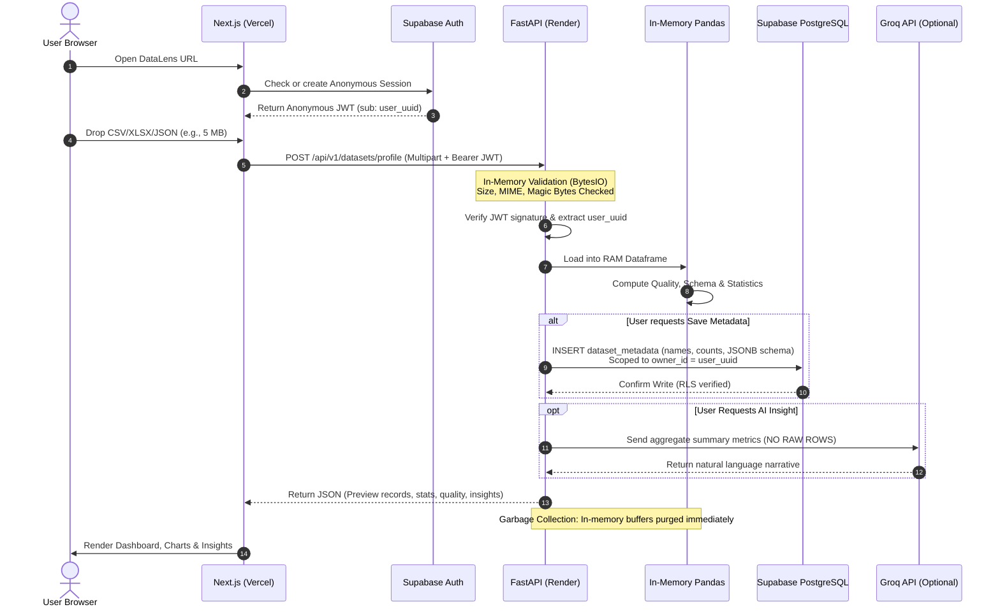
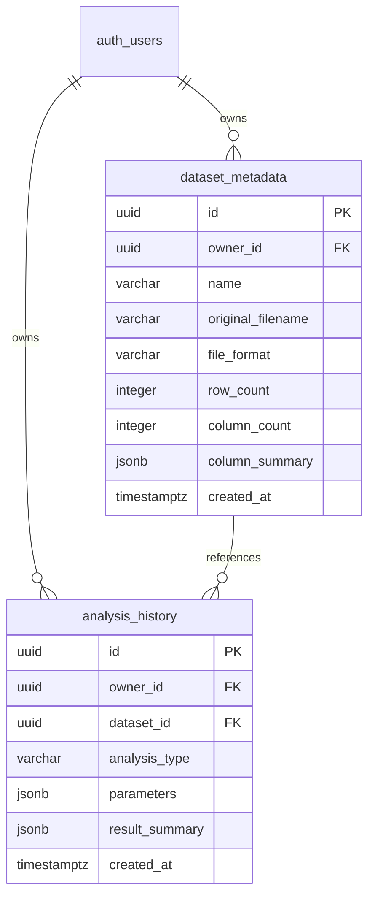
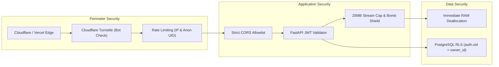
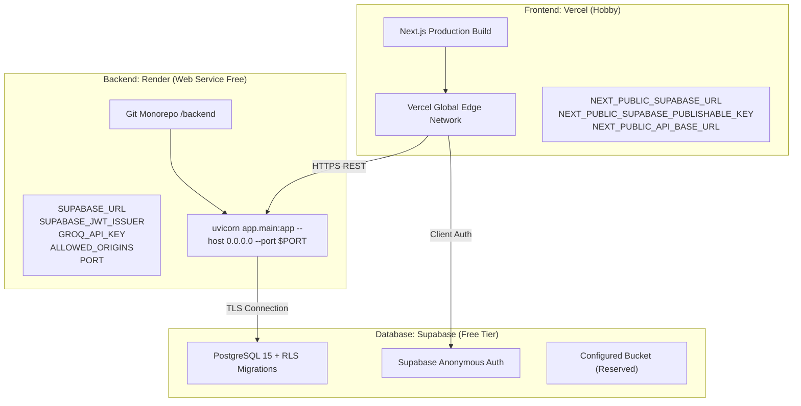

# DataLens: Implementation Plan & Architectural Blueprint (v2.0)

**Product:** DataLens  
**Version:** Cloud Architecture 2.0 (Updated from MVP 1.0)  
**Document Status:** Final Technical Specification & Implementation Plan  
**Architecture:** Cloud-Hosted 3-Tier Web Application (Next.js + FastAPI + Supabase + Groq)  
**Document Authors:** Senior Software Architect, Product Manager, and Technical Documentation Engineer  

---

## 1. Executive Summary

DataLens v2.0 transitions the platform from a local-first, desktop-centric prototype to a **cloud-hosted, browser-based data analytics and developer service**. 

The core mission remains unchanged: **"Upload your data. Understand it. Discover what matters."** However, the operating model has been fundamentally modernized to eliminate software installation barriers, maximize user privacy through **memory-only file processing**, leverage **Supabase Anonymous Authentication** for frictionless access, and utilize modern cloud platforms (Vercel, Render, Supabase, and optional Groq AI) within free-tier capabilities.

### Key Architectural Shifts from v1.0 to v2.0
- **Deployment Model:** Migrated from local desktop / local FastAPI sidecar to a globally accessible cloud architecture (Next.js on Vercel, FastAPI on Render).
- **Metadata Persistence:** Migrated from local SQLite (`datalens.db`) to **Supabase PostgreSQL** with Row-Level Security (RLS).
- **Dataset Storage Policy:** Eliminated local disk persistence. Raw dataset files are **never permanently stored** on Render disks or in Supabase Storage. All dataset processing occurs strictly in **backend RAM (memory-only)** and is purged immediately after computation.
- **Authentication:** Adopted **Supabase Anonymous Auth**, allowing instant, zero-friction exploration without mandatory email/password registration, while preserving isolated metadata ownership.
- **AI Integration:** Introduced **optional Groq API integration** for natural-language inquiries, statistical explanations, and automated insight narratives—while guaranteeing core analytics function 100% independently without AI.
- **Export Capabilities:** Promoted on-demand **PDF (ReportLab)** and **CSV exports** into the core MVP.

---

## 2. Product Vision and Scope

### 2.1 Product Vision
To provide individuals, students, analysts, and developers with an instant, zero-install, privacy-first data analytics workspace in the cloud. Users upload tabular datasets, immediately inspect data hygiene, uncover statistical distributions, view interactive visualizations, ask natural language questions, and export executive-ready reports—with the absolute guarantee that their raw dataset is never retained on cloud servers.

### 2.2 Product Principles
1. **Frictionless Onboarding:** Instant browser access; no desktop installers, no mandatory signup forms, and no credit cards.
2. **Zero-Retention Privacy:** Raw user data exists exclusively in volatile server memory during analysis request execution.
3. **Deterministic Core:** All mathematical summaries, data quality metrics, and aggregations are 100% reproducible and verifiable via Pandas; AI is strictly an interpretive companion.
4. **Autonomous Degradation:** If external AI services (Groq) or free-tier quotas are exhausted, core analytical and visualization capabilities remain completely operational.
5. **Cost-Conscious Architecture:** Designed to operate sustainably on reputable cloud free tiers (Vercel Hobby, Render Free, Supabase Free).

---

## 3. Updated Product Requirements

### 3.1 Functional Requirements Matrix

| ID | Functional Requirement | Priority | Target Tier |
|---|---|---|---|
| **FR-01** | Public web access via standard modern browsers without installation | P0 | MVP |
| **FR-02** | Frictionless anonymous user session creation via Supabase Anonymous Auth | P0 | MVP |
| **FR-03** | In-memory upload and ingestion of CSV files (UTF-8, Latin-1, delimiter sniffing) | P0 | MVP |
| **FR-04** | In-memory upload and ingestion of Excel workbooks (.xlsx via openpyxl) | P0 | MVP |
| **FR-05** | In-memory upload and ingestion of JSON files (arrays of objects, records) | P0 | MVP |
| **FR-06** | Strict file validation: extension, MIME signature, decompression bomb check, 25MB limit | P0 | MVP |
| **FR-07** | Strict memory-only dataset processing (zero disk / cloud storage retention of raw rows) | P0 | MVP |
| **FR-08** | In-memory data quality inspection (missing cells, duplicate records, empty columns) | P0 | MVP |
| **FR-09** | Automatic column data type inference (numeric, string, datetime, boolean) | P0 | MVP |
| **FR-10** | Descriptive statistics calculation (count, mean, median, std, min, max, quartiles) | P0 | MVP |
| **FR-11** | Categorical frequency analysis and temporal range grouping | P0 | MVP |
| **FR-12** | Interactive chart generation using Recharts (Bar, Line, Pie, Histogram) | P0 | MVP |
| **FR-13** | Deterministic rule-based insights generation (dominant categories, top performers, skew) | P0 | MVP |
| **FR-14** | Optional natural language queries and explanations powered by Groq API | P1 | MVP Optional |
| **FR-15** | On-demand downloadable PDF report generation via ReportLab | P0 | MVP |
| **FR-16** | On-demand downloadable filtered / clean CSV export | P0 | MVP |
| **FR-17** | Persistence of sanitized dataset metadata and analysis summaries in Supabase | P0 | MVP |
| **FR-18** | User-controlled deletion of saved metadata with Row-Level Security enforcement | P0 | MVP |
| **FR-19** | Versioned Developer REST API (`/api/v1`) with OpenAPI / Swagger documentation | P0 | MVP |

### 3.2 Non-Functional Requirements
- **Memory Ceiling & Safety:** Peak RAM utilization per upload strictly bounded; requests exceeding 25MB or expanding beyond safe RAM limits are rejected immediately with HTTP 413.
- **Stateless Resilience:** Backend handles Render free-tier cold starts and container restarts cleanly without risking database corruption or data leakage.
- **Response Latency:** Standard tabular summaries (<10,000 rows) compute in under 1.5 seconds.
- **Visual Identity:** Adherence to the approved light Diwali-inspired aesthetic (warm ivory surfaces, antique gold accents, DM Sans and Playfair Display typography).

---

## 4. Feature Scope Matrix

| Category | Feature | Status | Notes |
|---|---|---|---|
| **Platform** | Cloud Web Application | **MVP** | Hosted on Vercel (Next.js) |
| **Platform** | Cloud Backend API | **MVP** | Hosted on Render (FastAPI) |
| **Platform** | Desktop Shell (Tauri / Electron) | **EXCLUDED** | Removed from scope |
| **Platform** | Local-First SQLite Database | **EXCLUDED** | Replaced by Supabase PostgreSQL |
| **Auth** | Supabase Anonymous Auth | **MVP** | Zero-friction session token |
| **Auth** | Traditional Email/Password / OAuth | **EXCLUDED** | Out of scope for MVP |
| **Auth** | Multi-Tenant Team Workspaces / RBAC | **EXCLUDED** | Out of scope for MVP |
| **Storage** | Memory-Only Upload Processing | **MVP** | Data purged immediately from RAM |
| **Storage** | Permanent Raw Dataset Disk Storage | **EXCLUDED** | Explicit privacy restriction |
| **Storage** | Supabase Storage Infrastructure | **RESERVED** | Bucket configured; zero raw uploads in MVP |
| **Storage** | Opt-In Persistent Dataset Cloud Drive | **FUTURE** | Post-MVP opt-in cloud drive |
| **Analytics** | Data Quality Engine | **MVP** | Missing, duplicates, type inference |
| **Analytics** | Descriptive Statistics & Aggregations | **MVP** | Pandas & NumPy computed |
| **Analytics** | Recharts Visualizations | **MVP** | Bar, Line, Pie, Distribution |
| **Analytics** | Deterministic Rule-Based Insights | **MVP** | Statistical heuristics (non-AI) |
| **Analytics** | SQL Query Explorer | **EXCLUDED** | Excluded from MVP |
| **AI** | Groq Natural Language Q&A | **OPTIONAL** | Gracefully disables if API key missing |
| **AI** | Groq Statistical Explanations | **OPTIONAL** | Summaries only; no raw dataset sent |
| **AI** | Autonomous Agents / Code Execution | **EXCLUDED** | Strict security boundary |
| **Exports** | Downloadable PDF Report (ReportLab) | **MVP** | On-demand generation |
| **Exports** | Downloadable Cleaned CSV | **MVP** | In-memory streaming export |
| **Developer**| Versioned REST API (`/api/v1`) | **MVP** | Documented via Swagger UI |

---

## 5. Final Technology Stack

| Layer | Component | Selection | Responsibility / Rationale |
|---|---|---|---|
| **Frontend Framework** | Web App | **Next.js 14+ (App Router)** | Server & client components, responsive layout, SEO, routing |
| **Frontend Language** | Language | **TypeScript 5.x** | Static type safety and strict schema alignment with API |
| **Frontend Styling** | Styling | **Tailwind CSS** | Custom design tokens for Diwali light aesthetic |
| **Visualization** | Charts | **Recharts** | Declarative, responsive React charting engine |
| **Icons & UI** | Component Icons | **Lucide React** | Clean, lightweight icon suite |
| **Frontend Hosting** | Cloud PaaS | **Vercel (Hobby)** | Zero-config edge deployment, global CDN, instant Next.js builds |
| **Backend Framework** | Web API | **FastAPI (Python 3.11+)** | High-performance asynchronous REST API, automatic OpenAPI docs |
| **Backend Runtime** | ASGI Server | **Uvicorn** | Production-ready ASGI server bound to Render `$PORT` |
| **Data Engine** | Computation | **Pandas 2.2+ & NumPy** | In-memory dataframe manipulation, stats, aggregations |
| **Excel Ingestion** | Spreadsheet Parser| **openpyxl** | Streaming XLSX worksheet inspection and extraction |
| **PDF Generation** | Document Builder | **ReportLab** | Programmatic, on-demand PDF report rendering |
| **Authentication** | Identity Provider | **Supabase Anonymous Auth** | Zero-friction anonymous JWT session issuance |
| **Database** | Relational DB | **Supabase PostgreSQL** | Managed Postgres with Row-Level Security (RLS) |
| **Object Storage** | Cloud Storage | **Supabase Storage** | Bucket created for architectural compliance; unpopulated in MVP |
| **AI Provider** | LLM Engine | **Groq Cloud API** | Fast, low-latency Llama-3 inference for optional natural insights |
| **Backend Hosting** | Cloud PaaS | **Render (Web Service)** | Containerized Python runtime with native HTTPS and Git triggers |

---

## 6. Cloud Architecture

DataLens v2.0 is structured as a decoupled, 3-tier cloud application:

```mermaid
flowchart TD
    subgraph Users ["User Layer"]
        Browser["User Web Browser (Desktop / Mobile)"]
    end

    subgraph Vercel ["Vercel Edge Platform"]
        NextJS["Next.js 14+ App Router (TypeScript + Tailwind)"]
        Recharts["Recharts Visualization Engine"]
        SupabaseClient["Supabase JS Client (Anonymous Session)"]
    end

    subgraph Render ["Render Cloud Platform (FastAPI Backend)"]
        API["FastAPI Application (/api/v1)"]
        AuthMiddleware["JWT Verification Middleware"]
        MemoryPipe["In-Memory Processing Engine (BytesIO)"]
        PandasEngine["Pandas & NumPy Analytics Core"]
        ReportLab["ReportLab PDF Generator"]
        GroqClient["Groq AI Client (Optional)"]
    end

    subgraph SupabasePlatform ["Supabase Cloud Platform"]
        Postgres[(PostgreSQL Database + RLS)]
        AnonAuth["Supabase Anonymous Auth Service"]
        StorageBucket["Supabase Storage (Reserved / Unused in MVP)"]
    end

    subgraph ExternalAI ["External AI Services"]
        Groq["Groq Cloud LLM API (Llama-3)"]
    end

    Browser <-->|HTTPS / User Interface| NextJS
    NextJS <-->|Initialize Anonymous Session| AnonAuth
    NextJS -->|Bearer JWT + Multipart File / Payload| API

    API --> AuthMiddleware
    AuthMiddleware -->|Validate Claims & uid| AnonAuth
    API --> MemoryPipe
    MemoryPipe --> PandasEngine
    PandasEngine --> ReportLab
    PandasEngine -.->|Aggregate Summaries Only| GroqClient
    GroqClient -.->|REST / TLS| Groq

    API <-->|SQL over TLS (RLS Scoped)| Postgres
    NextJS -.->|Direct Read Scoped by RLS| Postgres
```

### Architectural Component Responsibilities:
1. **Frontend (Vercel):** Manages anonymous user identity, provides the drag-and-drop file ingestion zone, renders interactive Recharts, displays deterministic rule insights, handles PDF/CSV downloads, and streams conversational AI responses.
2. **Backend (Render):** Validates inbound file streams in RAM, parses workbooks and JSON documents, computes descriptive statistics, calculates data quality metrics, formats chart payloads, coordinates optional Groq interpretations, renders PDFs, and writes sanitized dataset metadata to Supabase.
3. **Database (Supabase):** Stores user metadata, column profiles, and saved analysis snapshots. Enforces strict cryptographic isolation between anonymous users via PostgreSQL Row-Level Security.
4. **Storage (Supabase):** Provisioned for future roadmap milestones. **Zero raw dataset files are stored here during MVP.**

---

## 7. Data Flow (End-to-End Memory-Only Lifecycle)

The lifecycle of an uploaded dataset guarantees complete zero-retention privacy:



---

## 8. Anonymous Authentication Architecture

DataLens implements **Supabase Anonymous Auth** to eliminate the friction of traditional registration while preventing data cross-contamination.

### 8.1 User Journey & Session Lifecycle
1. **Session Bootstrapping:** When a user navigates to the application, the Next.js Supabase client checks `localStorage` for an existing Supabase session.
2. **Anonymous Identity Generation:** If absent, the client executes `supabase.auth.signInAnonymously()`. Supabase generates an anonymous user record in `auth.users` with `is_anonymous = true` and returns a signed JWT containing the user's UUID in the `sub` claim.
3. **API Scoping:** All subsequent HTTP calls from Next.js to FastAPI include `Authorization: Bearer <JWT>`.
4. **Backend Token Verification:** FastAPI intercepts requests via `JWTBearerMiddleware`:
   - Validates token signature against Supabase JWKS / JWT Secret.
   - Verifies expiration (`exp`), issuer (`iss`), and audience (`aud`).
   - Extracts `user_id = payload["sub"]`.
   - Rejects unauthenticated or forged requests with HTTP 401 Unauthorized.

### 8.2 Architectural Realities & Limitations
- **No Recovery Mechanism:** If a user clears their browser cookies and `localStorage`, their anonymous session token is lost permanently. Previous saved metadata cannot be recovered.
- **Single-Device Bounded:** Anonymous sessions do not sync across browsers or devices.
- **Abuse Countermeasures:**
  - Cloudflare Turnstile or Supabase CAPTCHA configured on anonymous signup to prevent programmatic bot spam.
  - Per-IP rate limiting applied at Render and Supabase gateway levels.
  - Supabase database cron job scheduled to prune orphaned anonymous records inactive for >30 days.

---

## 9. File Ingestion & Memory-Only Processing Engine

### 9.1 Memory-Only Execution Workflow
To honor the zero-retention guarantee, files are never written to the Render host filesystem or uploaded to object storage:
1. Inbound multipart stream is read directly into Python `io.BytesIO`.
2. Content size is checked on the fly; if payload exceeds 25 MB, streaming halts immediately with HTTP 413.
3. Magic bytes and MIME types are inspected in-memory.
4. Data is parsed directly into a Pandas `DataFrame`.
5. Tabular analytics, data quality matrices, and preview records (capped at first 50 rows) are generated.
6. The `BytesIO` buffer is explicitly closed, the `DataFrame` reference is released, and Python garbage collection is triggered.

### 9.2 Format-Specific Processing Rules

| Format | Parsing Protocol | Edge Case Handling |
|---|---|---|
| **CSV** | `pandas.read_csv(io.BytesIO)` | Automatic encoding detection (`charset-normalizer` / `utf-8-sig` / `latin-1`), delimiter sniffing (`,`, `;`, `\t`, `\|`), bad line skipping with user warning |
| **XLSX** | `openpyxl.load_workbook(read_only=True)` | Active sheet default extraction; XML entity expansion protection (defusedxml / zip bomb defense); formula evaluation fallback |
| **JSON** | `json.loads` + `pandas.json_normalize` | Arrays of uniform objects or records-oriented schemas; deeply nested hierarchies produce structured warnings rather than silent corruption |

### 9.3 Ingestion Security Checklist
- [x] **File Extension vs. Magic Byte Matching:** Verification that `.csv` is textual, `.xlsx` has PK zip headers (`50 4B 03 04`), and `.json` is valid UTF JSON.
- [x] **Decompression Bomb Protection:** Strict zip extraction ratios enforced on `.xlsx` files to defeat malicious nested compression attacks.
- [x] **Processing Timeout:** Execution capped at 15 seconds per file via `asyncio.wait_for`.
- [x] **No Raw Row Persistence:** No raw cell values are written to Postgres or logs.

---

## 10. Supabase Database Design

The database stores only **sanitized metadata and aggregated summaries**. All tables reside in Supabase PostgreSQL with **Row-Level Security (RLS)** strictly enabled.



### 10.1 Table Definitions & DDL

#### Table: `dataset_metadata`
```sql
CREATE TABLE public.dataset_metadata (
    id UUID PRIMARY KEY DEFAULT gen_random_uuid(),
    owner_id UUID NOT NULL REFERENCES auth.users(id) ON DELETE CASCADE,
    name VARCHAR(255) NOT NULL,
    original_filename VARCHAR(255) NOT NULL,
    file_format VARCHAR(10) NOT NULL CHECK (file_format IN ('csv', 'xlsx', 'json')),
    row_count INTEGER NOT NULL CHECK (row_count >= 0),
    column_count INTEGER NOT NULL CHECK (column_count > 0),
    column_summary JSONB NOT NULL DEFAULT '[]'::jsonb,
    created_at TIMESTAMPTZ NOT NULL DEFAULT timezone('utc'::text, now())
);

-- Enable RLS
ALTER TABLE public.dataset_metadata ENABLE ROW LEVEL SECURITY;

-- RLS Policies
CREATE POLICY "Users can only view their own dataset metadata"
    ON public.dataset_metadata FOR SELECT
    USING (auth.uid() = owner_id);

CREATE POLICY "Users can only insert their own dataset metadata"
    ON public.dataset_metadata FOR INSERT
    WITH CHECK (auth.uid() = owner_id);

CREATE POLICY "Users can only delete their own dataset metadata"
    ON public.dataset_metadata FOR DELETE
    USING (auth.uid() = owner_id);
```

#### Table: `analysis_history`
```sql
CREATE TABLE public.analysis_history (
    id UUID PRIMARY KEY DEFAULT gen_random_uuid(),
    owner_id UUID NOT NULL REFERENCES auth.users(id) ON DELETE CASCADE,
    dataset_id UUID REFERENCES public.dataset_metadata(id) ON DELETE CASCADE,
    analysis_type VARCHAR(50) NOT NULL,
    parameters JSONB NOT NULL DEFAULT '{}'::jsonb,
    result_summary JSONB NOT NULL DEFAULT '{}'::jsonb,
    created_at TIMESTAMPTZ NOT NULL DEFAULT timezone('utc'::text, now())
);

-- Enable RLS
ALTER TABLE public.analysis_history ENABLE ROW LEVEL SECURITY;

-- RLS Policies
CREATE POLICY "Users can only view their own analysis history"
    ON public.analysis_history FOR SELECT
    USING (auth.uid() = owner_id);

CREATE POLICY "Users can only insert their own analysis history"
    ON public.analysis_history FOR INSERT
    WITH CHECK (auth.uid() = owner_id);

CREATE POLICY "Users can only delete their own analysis history"
    ON public.analysis_history FOR DELETE
    USING (auth.uid() = owner_id);
```

---

## 11. Supabase Storage Strategy (Architectural Reservation)

- **Configuration:** A private bucket named `datalens-assets` is created via Supabase initialization scripts.
- **MVP Usage Policy:** **Zero bytes of raw user datasets are written to this bucket.** 
- **Future Roadmap Role:** The bucket configuration is maintained so that post-MVP capabilities (such as user-requested persistent dataset caching, saved PDF report archives, or shared public dashboard assets) can be activated without structural schema changes.

---

## 12. Backend API Specification

All backend endpoints are prefixed with `/api/v1` and document strict Pydantic schemas.

| Method | Endpoint | Purpose | Auth Required | Request Type | Expected Status |
|---|---|---|---|---|---|
| `GET` | `/api/v1/health` | Service health & environment readiness | No | None | `200 OK` |
| `POST` | `/api/v1/datasets/preview` | In-memory upload -> bounded preview rows & schema | Yes (Anon) | `multipart/form-data` | `200 OK`, `413`, `415` |
| `POST` | `/api/v1/datasets/profile` | In-memory upload -> comprehensive quality audit | Yes (Anon) | `multipart/form-data` | `200 OK`, `422` |
| `POST` | `/api/v1/analytics/summary` | Descriptive statistics (numeric, categorical, temporal) | Yes (Anon) | `multipart/form-data` | `200 OK` |
| `POST` | `/api/v1/analytics/aggregate` | Group-by aggregation (sum, mean, count) | Yes (Anon) | `multipart/form-data` | `200 OK` |
| `POST` | `/api/v1/analytics/chart-data`| Structured chart-ready payloads for Recharts | Yes (Anon) | `multipart/form-data` | `200 OK` |
| `POST` | `/api/v1/insights/rules` | Deterministic heuristic insights (non-AI) | Yes (Anon) | `multipart/form-data` | `200 OK` |
| `POST` | `/api/v1/ai/query` | Natural-language questions via Groq (summaries only)| Yes (Anon) | `application/json` | `200 OK`, `503` |
| `POST` | `/api/v1/exports/csv` | Cleaned / filtered CSV on-demand streaming export | Yes (Anon) | `multipart/form-data` | `200 OK` |
| `POST` | `/api/v1/exports/pdf` | Executive summary PDF generation (ReportLab) | Yes (Anon) | `multipart/form-data` | `200 OK` |
| `GET` | `/api/v1/datasets/saved` | List anonymous user's saved metadata records | Yes (Anon) | None | `200 OK` |
| `DELETE`| `/api/v1/datasets/saved/{id}`| Remove specific saved metadata record | Yes (Anon) | None | `200 OK`, `404` |

---

## 13. Analytics and Data Quality Engine

### 13.1 Data Quality Engine
The data quality engine executes deterministic checks directly on the in-memory dataframe:
- **Missing Value Audit:** Computes total missing cells across the matrix, per-column null counts, and null percentages.
- **Duplicate Row Audit:** Detects exact duplicate records across all dimensions.
- **Empty Column Detection:** Identifies columns with 100% missing values.
- **Type Inference Matrix:** Infers concrete semantic types (`integer`, `float`, `string`, `datetime`, `boolean`) based on standard sample checks.

### 13.2 Descriptive Analytics
- **Numeric Fields:** Count, Mean, Median, Standard Deviation, Min, Max, 25% Quartile, 75% Quartile, Interquartile Range (IQR), and Skewness.
- **Categorical Fields:** Unique value count, Cardinality ratio, Top 10 frequent items with frequency percentages.
- **Temporal Fields:** Minimum timestamp, Maximum timestamp, Duration span, and distribution grouped by day/month/year.

---

## 14. Deterministic Rule-Based Insights Engine

To ensure analytical value even when offline or without external AI services, DataLens executes algorithmic insight heuristics:
1. **Dominant Category Detection:** Triggers when a single categorical value represents $>50\%$ of all valid rows.
2. **Extreme Outlier Indicator:** Evaluates numeric distributions using the $1.5 \times \text{IQR}$ rule and alerts the user if $>5\%$ of entries represent statistical outliers.
3. **Data Quality Warning:** Flags columns where missing data exceeds $20\%$ of total records.
4. **Cardinality Warning:** Flags string columns where unique values equal row count (identifying unindexed IDs or unique hashes).
5. **Top Performer Benchmark:** Identifies the maximum contributing category when grouped against primary numeric revenue/volume fields.

---

## 15. Optional Groq AI Integration

DataLens integrates Groq API (`llama-3-70b-versatile` or current active Groq model) as an optional, high-speed conversational layer.

### 15.1 Architectural Boundaries & Privacy Safeguards
- **Zero Raw Dataset Transmission:** Full raw datasets are **NEVER sent to Groq**. The backend extracts column names, data types, statistical metrics (mean, min, max), and quality indicators, sending only this condensed metadata summary to the LLM.
- **Backend-Only Credentials:** The `GROQ_API_KEY` resides strictly on Render; no client-side API requests are permitted.
- **No Code Execution:** Groq responses are parsed strictly as text or structured JSON. The application will never execute Python, SQL, or shell scripts generated by the model.
- **Graceful Degradation:** If `GROQ_API_KEY` is missing or Groq rate limits are encountered:
  - The API returns HTTP 503 with a user-friendly message: `"AI insight service temporarily unavailable. Core analytics remain fully functional."`
  - The frontend hides or disables the AI tab while keeping all charts, tables, and rule-based insights active.

---

## 16. Frontend Architecture (Next.js & Visual System)

### 16.1 Application Routes & Component Architecture
The frontend leverages the Next.js App Router:
- `/` — Workspace Dashboard (session statistics, quick upload dropzone, recent metadata).
- `/datasets/upload` — Dedicated upload dropzone with client-side file inspection.
- `/datasets/[id]` — Interactive tabular explorer with bounded virtualized preview.
- `/datasets/[id]/quality` — Visual data quality report and hygiene audit.
- `/datasets/[id]/analytics` — Analytics Studio with dynamic Recharts (Bar, Line, Pie, Histogram).
- `/datasets/[id]/insights` — Rule-based insights card deck and optional Groq AI Q&A panel.
- `/developer` — Interactive API catalog with copyable cURL snippets and Swagger links.

### 16.2 Diwali-Inspired Visual Design System
A light-first, radiant aesthetic designed for data legibility:

| Design Token | Hex Code | Visual Application |
|---|---|---|
| **Background** | `#FFFDF8` | Main page canvas (warm ivory) |
| **Surface** | `#FFFFFF` | Elevated cards, tables, modal containers |
| **Primary** | `#9B681E` | Primary action buttons, active navigation indicators |
| **Gold** | `#C99A3A` | KPI accent borders, highlight badges, score indicators |
| **Saffron** | `#E9A23B` | Upload dropzone hover state, callout alerts |
| **Deep Maroon** | `#713B36` | Critical quality alerts, deletion actions |
| **Text Primary** | `#28251F` | High-contrast body typography and headers |
| **Text Muted** | `#817B70` | Column types, secondary timestamps, helper text |
| **Border** | `#EEE7D9` | Table row dividers and card outlines |

**Typography:**
- Headers: `Playfair Display` (classic serif, conveying elegance).
- Body & Tables: `DM Sans` (clean modern sans-serif with `tabular-nums` for numeric alignment).

---

## 17. Security, Privacy & Abuse Architecture



### 17.1 Security & Threat Mitigation Matrix
1. **Anonymous Abuse & Spam:** Protected via Cloudflare Turnstile on the upload action and backend IP-based rate limiting (max 30 requests/minute per IP).
2. **CORS Governance:** FastAPI explicitly allows only the deployed Vercel domain and `localhost:3000` during development. Wildcards (`*`) are disallowed.
3. **Database Integrity:** PostgreSQL Row-Level Security guarantees anonymous User A cannot view, mutate, or delete User B's saved metadata.
4. **No Server-Side Code Execution:** No arbitrary code execution engines (eval, exec) are utilized.

---

## 18. Deployment Architecture & Infrastructure

DataLens deploys across three specialized cloud providers:



---

## 19. Environment Variable Reference

### Frontend Environment Variables (`frontend/.env.production`)
| Variable Name | Required | Exposure | Description |
|---|---|---|---|
| `NEXT_PUBLIC_SUPABASE_URL` | Yes | Public | URL of the Supabase project |
| `NEXT_PUBLIC_SUPABASE_PUBLISHABLE_KEY` | Yes | Public | Supabase Anon/Publishable API Key |
| `NEXT_PUBLIC_API_BASE_URL` | Yes | Public | Render FastAPI base URL (e.g. `https://datalens-api.onrender.com/api/v1`) |

### Backend Environment Variables (`backend/.env`)
| Variable Name | Required | Exposure | Description |
|---|---|---|---|
| `SUPABASE_URL` | Yes | Private | Supabase project URL |
| `SUPABASE_SERVICE_ROLE_KEY` | Yes | Private | Supabase Service Role key (backend admin tasks only) |
| `SUPABASE_JWT_ISSUER` | Yes | Private | Trusted Supabase JWT Issuer URI for token verification |
| `GROQ_API_KEY` | Optional | Private | Groq Cloud API authentication key |
| `ALLOWED_ORIGINS` | Yes | Private | Comma-separated list of allowed origins (e.g. `https://datalens.vercel.app`) |
| `MAX_UPLOAD_SIZE_MB` | No | Private | Max upload threshold in megabytes (default: `25`) |
| `PORT` | Auto | Private | Dynamically injected by Render host |

---

## 20. Free-Tier & Cost Considerations

| Provider | Selected Tier | Known Limitations | Mitigation Strategy |
|---|---|---|---|
| **Vercel** | Hobby | Non-commercial use, 100GB bandwidth limit | Lightweight asset bundling, external API delegation |
| **Render** | Free Web Service | Container spins down after 15 min of inactivity; 50-second cold start | Frontend displays warm-up banner on initial ping; keep-alive ping optional |
| **Supabase** | Free Tier | 500MB database, project pauses after 7 days of inactivity | Store only lean JSONB summaries; heartbeat script maintains activity |
| **Groq Cloud** | Free Developer Tier | Daily request limits & token rate limits | Aggregate data minimization; automatic fallback to deterministic insights |

---

## 21. Testing Strategy

### 21.1 Automated Test Suites
- **Backend Unit Tests (Pytest):**
  - Validation of CSV delimiter sniffing and irregular encodings.
  - In-memory parsing of multi-sheet XLSX documents.
  - Verification of mathematical descriptive statistics against pre-calculated fixtures.
  - Correct execution of ReportLab PDF generation in RAM.
- **Security & RLS Tests:**
  - Mocked JWT requests verifying cross-tenant isolation in Supabase.
  - Attempted metadata deletion using mismatched `owner_id` (must return HTTP 403/404).
- **Frontend Integration Tests:**
  - Anonymous session creation and recovery.
  - Drag-and-drop file upload error states (file >25MB triggers alert without API transmission).
  - Clean rendering of Recharts components.
  - Graceful degradation when Groq API returns HTTP 503.

---

## 22. Updated Project Directory Structure

```
DataLens/
├── frontend/
│   ├── app/
│   │   ├── layout.tsx                  # Root layout with Diwali theme tokens
│   │   ├── page.tsx                    # Workspace Dashboard
│   │   ├── datasets/
│   │   │   ├── upload/page.tsx         # Drag-and-drop upload view
│   │   │   └── [id]/
│   │   │       ├── page.tsx            # Tabular Explorer
│   │   │       ├── quality/page.tsx    # Data Quality Report
│   │   │       └── analytics/page.tsx  # Analytics Studio & Recharts
│   │   └── developer/page.tsx          # Developer REST API Portal
│   ├── components/
│   │   ├── layout/                     # Sidebar, Header, WarmupBanner
│   │   ├── dashboard/                  # KPI cards, RecentDatasets
│   │   ├── datasets/                   # UploadDropzone, PreviewGrid
│   │   ├── quality/                    # QualityMatrix, ColumnAuditTable
│   │   ├── analytics/                  # ChartViewer, DescriptiveSummary
│   │   ├── insights/                   # RuleInsightCards, GroqChatPanel
│   │   └── ui/                         # Buttons, Modals, Badges, Tabs
│   ├── lib/
│   │   ├── supabaseClient.ts           # Supabase client (Anonymous Auth)
│   │   ├── apiClient.ts                # Axios client to Render backend
│   │   └── utils.ts
│   ├── types/                          # Shared TypeScript interfaces
│   ├── tailwind.config.ts              # Theme palette configuration
│   ├── package.json
│   └── tsconfig.json
│
├── backend/
│   ├── app/
│   │   ├── __init__.py
│   │   ├── main.py                     # FastAPI entrypoint, CORS & error handlers
│   │   ├── api/
│   │   │   └── v1/
│   │   │       ├── router.py           # Master router (/api/v1)
│   │   │       ├── endpoints/
│   │   │       │   ├── health.py       # Health check
│   │   │       │   ├── datasets.py     # Ingestion, preview, profiling
│   │   │       │   ├── analytics.py    # Descriptive stats, chart data
│   │   │       │   ├── insights.py     # Rule-based insights
│   │   │       │   ├── ai.py           # Optional Groq integration
│   │   │       │   └── exports.py      # PDF & CSV generation
│   │   │       └── deps.py             # Auth & user extraction dependencies
│   │   ├── core/
│   │   │   ├── config.py               # Pydantic BaseSettings & env vars
│   │   │   └── security.py             # JWT verification & claims decoding
│   │   ├── services/
│   │   │   ├── ingestion/              # In-memory CSV, XLSX, JSON readers
│   │   │   ├── quality/                # Quality audit & null detectors
│   │   │   ├── analytics/              # Pandas descriptive statistics
│   │   │   ├── insights/               # Deterministic rule engine
│   │   │   ├── ai/                     # Groq client wrapper
│   │   │   ├── exports/                # ReportLab PDF & CSV builders
│   │   │   └── supabase/               # Supabase DB client & RLS helpers
│   │   └── schemas/                    # Pydantic request & response models
│   ├── tests/                          # Pytest unit & integration suites
│   ├── requirements.txt                # Pinned backend dependencies
│   └── Procfile                        # Render start command
│
├── supabase/
│   ├── migrations/
│   │   └── 20261109000001_init.sql     # PostgreSQL schemas & RLS policies
│   └── config.toml
│
├── docs/
│   ├── PRD.md
│   ├── ARCHITECTURE.md
│   └── API_SPECIFICATION.md
│
├── .gitignore
└── README.md
```

---

## 23. Deployment Checklist

### Step 1: Supabase Configuration
- [ ] Create a new Supabase project (select closest region).
- [ ] Navigate to **Authentication > Providers** and enable **Anonymous Sign-Ins**.
- [ ] Execute database migration script (`supabase/migrations/20261109000001_init.sql`) via Supabase SQL Editor.
- [ ] Verify that RLS is active on `dataset_metadata` and `analysis_history`.
- [ ] Create the private storage bucket `datalens-assets`.
- [ ] Copy `Project URL`, `anon/publishable key`, and `service_role key`.

### Step 2: Render Backend Deployment
- [ ] Connect repository to Render as a new **Web Service**.
- [ ] Set Root Directory to `backend`.
- [ ] Configure Environment: `Python 3`.
- [ ] Set Build Command: `pip install -r requirements.txt`.
- [ ] Set Start Command: `uvicorn app.main:app --host 0.0.0.0 --port $PORT`.
- [ ] Populate Environment Variables (`SUPABASE_URL`, `SUPABASE_JWT_ISSUER`, `GROQ_API_KEY`, `ALLOWED_ORIGINS`).
- [ ] Trigger deployment and verify `https://<render-url>/api/v1/health`.

### Step 3: Vercel Frontend Deployment
- [ ] Connect repository to Vercel as a new Project.
- [ ] Set Root Directory to `frontend`.
- [ ] Populate Environment Variables (`NEXT_PUBLIC_SUPABASE_URL`, `NEXT_PUBLIC_SUPABASE_PUBLISHABLE_KEY`, `NEXT_PUBLIC_API_BASE_URL`).
- [ ] Deploy and verify production DNS.
- [ ] Update Render's `ALLOWED_ORIGINS` to include the verified Vercel production URL.

---

## 24. MVP Definition of Done

The DataLens Cloud MVP 2.0 release is complete when:
1. The web application is publicly reachable at a Vercel URL over HTTPS.
2. Visiting the application initializes a Supabase anonymous session without prompting for login credentials.
3. Users can drag-and-drop CSV, XLSX, and JSON files up to 25MB.
4. Uploaded files are processed strictly in backend RAM without disk persistence.
5. In-memory data quality inspection returns accurate counts of missing values, duplicates, and column types.
6. Descriptive statistics (mean, median, quartiles) match verification test fixtures.
7. Interactive Recharts (Bar, Line, Pie, Histogram) render cleanly with the light Diwali theme.
8. Deterministic rule-based insights display without requiring external AI services.
9. Optional Groq AI responds to natural language queries when configured, and degrades gracefully when unconfigured.
10. Users can download a clean CSV and an executive PDF report generated by ReportLab.
11. Saved dataset metadata persists in Supabase PostgreSQL under strict RLS isolation.
12. Deleting a saved dataset removes the metadata record from Supabase immediately.
13. Backend OpenAPI documentation is accessible at `/docs`.
14. Automated Pytest suites pass with zero regressions.

---

## 25. Future Roadmap

### V2.1 — Persistent Storage & Registered Accounts (Post-MVP)
- Optional user upgrade from anonymous to verified email/password or OAuth account.
- User-consented persistent dataset storage using Supabase Storage.
- Cross-device workspace synchronization.

### V2.2 — Advanced Analytical Workflows
- Multi-dataset joins and tabular merges.
- Custom formula builder and column transformations.
- SQL Explorer for read-only querying of user-persisted tables.

### V2.3 — Autonomous Data Agent
- Multi-step conversational analysis workflows.
- Automated anomaly detection using machine learning models.
- Scheduled email analytical briefings.

---

## 26. Open Decisions and Architectural Risks

| Risk / Decision Item | Category | Description | Status / Architectural Guidance |
|---|---|---|---|
| **Cleanliness Ratio Formula** | Open Decision | The PRD mentions an overall dataset cleanliness metric without specifying the mathematical weighting between null cells, duplicate rows, and empty columns. | **Documented as Open Decision:** Recommended formula for MVP: $\text{Score} = 100 \times \left(1 - \frac{\text{Missing Cells} + (\text{Duplicate Rows} \times \text{Col Count})}{\text{Total Rows} \times \text{Col Count}}\right)$. Requires final stakeholder sign-off. |
| **Excel Multi-Sheet UX** | Open Decision | Excel workbooks can contain multiple worksheets. | **Documented as Open Decision:** MVP default imports the first active sheet; user selection dialog flagged as a potential Phase 2 refinement. |
| **Render Cold Start Latency** | Risk | Render free-tier spins down after 15 minutes of inactivity, resulting in a ~50s delay on the first file upload. | **Mitigation:** Frontend implements an initial health-check ping on page load with a warm-up progress banner if the backend is waking. |
| **Anonymous Session Abandonment** | Risk | Anonymous users clearing cache will accumulate orphaned metadata rows in Supabase. | **Mitigation:** Supabase scheduled pg_cron job will automatically delete metadata belonging to anonymous users inactive for $>30$ days. |
| **Groq Free-Tier Rate Limits** | Risk | Concurrent user queries could exceed Groq's free-tier requests-per-minute (RPM) limits. | **Mitigation:** Backend caches identical question embeddings and falls back gracefully to rule-based insights on HTTP 429. |

---

## 27. Concise Summary of Changes from Plan v1.0 to v2.0

1. **Architecture Pivot:** Abandoned the local-first modular monolith / desktop model. Shifted completely to a cloud-native architecture (Next.js on Vercel + FastAPI on Render).
2. **Database Replacement:** Replaced local SQLite (`datalens.db`) with **Supabase PostgreSQL** protected by Row-Level Security (RLS).
3. **Strict Memory-Only Processing:** Eliminated local filesystem storage (`datalens-data/`). Inbound files are processed exclusively in RAM (`io.BytesIO`) and purged after the request cycle.
4. **Frictionless Anonymous Identity:** Replaced "no authentication" with **Supabase Anonymous Auth**, giving every user an isolated cryptographically secure session without registration.
5. **AI Integration:** Promoted **Groq API** from a future consideration to an optional MVP feature for natural language Q&A and narrative summaries, bounded by strict data minimization.
6. **Export Capabilities:** Promoted **ReportLab PDF** and **CSV streaming exports** from post-MVP to core MVP deliverables.
7. **Production Security:** Added Cloudflare Turnstile bot deterrence, CORS origin restrictions, JWT claim verification, and decompression-bomb defenses.
8. **Cost Optimization:** Explicitly aligned all infrastructure with the free tiers of Vercel, Render, and Supabase.

